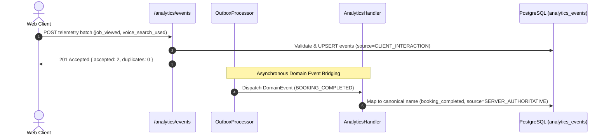

# LocalSaathi — Product Analytics Platform Architecture (Phase 16)

## 1. Overview & Architectural Boundaries

The LocalSaathi Product Analytics Platform provides canonical event taxonomy, high-throughput client telemetry ingestion, transactional outbox event bridging, and operational analytics exploration.

### Core Non-Functional Requirements & Invariants:
1. **Source of Truth Invariant**: Analytics events are **never** the source of truth for business, financial, booking, moderation, or security state. Authoritative state lives strictly within transactional PostgreSQL tables (`JobPost`, `Booking`, `Payment`, `User`, `Report`, etc.).
2. **Privacy by Design & Data Minimization**: Prohibited metadata attributes (passwords, OTPs, session tokens, JWTs, PAN, Aadhaar, payment card details, and raw chat contents) are strictly scrubbed, rejected, or redacted (`[REDACTED_PRIVACY]`) before persistence.
3. **GDPR / Account Deletion Compliance**: When a user account is deleted or anonymization is requested, `anonymizeUserEvents(userId)` unlinks `userId` and `anonymousSessionId`, while preserving anonymized aggregate metric counts.
4. **Idempotency & Deduplication**: Every event is identified by a unique `eventId`. The PostgreSQL database enforces a unique constraint (`analytics_events_event_id_key`) allowing safe retries and deduplication.

---

## 2. Event Classification: Server-Authoritative vs Client-Interaction

Events are partitioned by source and access privileges:

```
┌─────────────────────────────────┐       ┌─────────────────────────────────┐
│     SERVER_AUTHORITATIVE        │       │       CLIENT_INTERACTION        │
├─────────────────────────────────┤       ├─────────────────────────────────┤
│ • Originates in backend code    │       │ • Originates in browser/mobile  │
│ • Triggered by Outbox Handler   │       │ • Ingested via /analytics/events│
│ • E.g.: booking_completed,      │       │ • E.g.: job_viewed,             │
│   payment_captured,             │       │   voice_search_used,            │
│   job_post_published            │       │   recommendation_clicked        │
│ • Cannot be posted via client   │       │ • Validated & Rate limited      │
└─────────────────────────────────┘       └─────────────────────────────────┘
```

---

## 3. Database Schema

The analytics platform uses the dedicated table `analytics_events`:

```prisma
model AnalyticsEvent {
  id                 String               @id @default(dbgenerated("gen_random_uuid()")) @db.Uuid
  eventId            String               @unique @map("event_id") @db.VarChar(128)
  eventName          String               @map("event_name") @db.VarChar(100)
  userId             String?              @map("user_id") @db.Uuid
  anonymousSessionId String?              @map("anonymous_session_id") @db.VarChar(128)
  platform           String               @default("WEB") @db.VarChar(32)
  appVersion         String               @default("1.0.0") @map("app_version") @db.VarChar(32)
  source             AnalyticsEventSource @default(SERVER_AUTHORITATIVE)
  correlationId      String?              @map("correlation_id") @db.VarChar(128)
  schemaVersion      Int                  @default(1) @map("schema_version")
  metadata           Json                 @default("{}")
  occurredAt         DateTime             @default(now()) @map("occurred_at")
  ingestedAt         DateTime             @default(now()) @map("ingested_at")

  user User? @relation(fields: [userId], references: [id], onDelete: SetNull)

  @@index([eventName, occurredAt(sort: Desc)])
  @@index([userId, occurredAt(sort: Desc)])
  @@index([anonymousSessionId, occurredAt(sort: Desc)])
  @@index([occurredAt(sort: Desc)])
  @@index([source, occurredAt(sort: Desc)])
  @@map("analytics_events")
}
```

---

## 4. Ingestion & Outbox Bridging Workflow


