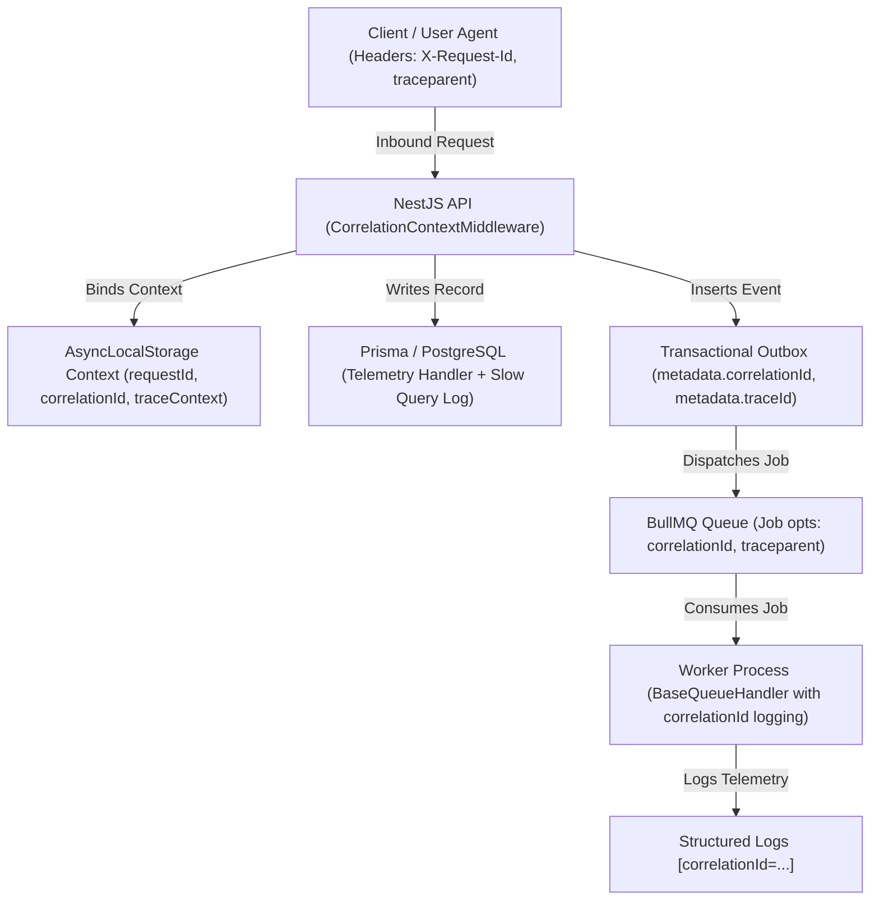

# LocalSaathi — Observability & Monitoring Platform Architecture (Phase 21 Hardened)

## 1. Executive Summary & Verification Status Matrix

LocalSaathi Phase 21 establishes an observability and telemetry architecture across all layers of the platform:
- Inbound HTTP traffic (Next.js client → NestJS API)
- Real-time WebSockets (Socket.IO cluster)
- Transactional storage (PostgreSQL 16 + PostGIS 3.4)
- Distributed caching & queues (Redis 7.2 + 12 BullMQ Queues)
- Asynchronous workers (`apps/worker`)
- Outbox event processors & notification pipelines

### 1.1 Verification & Capability Classification Matrix

| Capability | Classification | Verification Detail |
|---|---|---|
| Structured JSON Logging & Ambient Context | **VERIFIED LOCALLY** | Verified in `observability.spec.ts` via ambient `AsyncLocalStorage` |
| Deep Recursive Secret Redaction | **VERIFIED LOCALLY** | Verified in `observability.spec.ts` (17 credentials/PII keys tested) |
| W3C Trace Context-Compatible Propagation | **VERIFIED LOCALLY** | W3C `traceparent` parsing, formatting, and propagation verified |
| Instrumentation Microbenchmark Overhead | **MICROBENCHMARKED** | Measured microbenchmark overhead was 8.67 µs per benchmark iteration under documented benchmark workload |
| Controlled Concurrency Request Lifecycle | **VERIFIED LOCALLY** | 500 requests / 25 workers, throughput 11,279 req/s, p50: 1.83ms, p95: 3.25ms |
| Bounded Metric Cardinality Enforcement | **VERIFIED LOCALLY** | Automated guard rejecting 15 high-cardinality dimensions (`userId`, `jobId`, etc.) |
| Universal 10-Subsystem Runtime Diagnostics | **VERIFIED LOCALLY** | Diagnostic evaluator verifying all 10 subsystems with explicit reasons |
| Automated Alert Condition Detection | **FAILURE-INJECTED** | 5/5 failure scenarios verified in `test-observability-failures.js` |
| Local Alert Notification Protocol (`LogAlertNotifier`) | **VERIFIED LOCALLY** | Verified in `observability.spec.ts` via `AlertNotifier` mock and logger |
| External Incident Provider Delivery (Slack/PagerDuty) | **REQUIRES EXTERNAL CONFIGURATION** | Not active locally; requires external provider secrets and webhook endpoints |
| Zero-Overhead Production Guarantee | **NOT CLAIMED** | Instrumentation carries bounded computation overhead measured in microbenchmarks |
| End-to-End Production Latency SLA | **NOT CLAIMED** | Microbenchmarks test isolated computational units; real latency depends on network/DB I/O |

---

## 2. Distributed Tracing & W3C Trace Context-Compatible Propagation

### 2.1 Trace Propagation Anatomy



### 2.2 W3C Trace Context Compatibility
The platform implements W3C Trace Context-compatible propagation:
- Format: `00-${traceId}-${spanId}-${traceFlags}`
- `traceId`: 32-character hexadecimal string representing the root distributed transaction.
- `spanId`: 16-character hexadecimal string representing the local execution unit.
- `traceFlags`: `01` denoting recorded trace spans.

Inbound requests without headers automatically generate new 32-hex trace identifiers and 16-hex span identifiers, which are reflected in response headers `X-Request-Id`, `X-Correlation-Id`, and `traceparent`.

---

## 3. Centralized Structured Logging & Secret Redaction Pipeline

### 3.1 Production JSON Schema
In production (`NODE_ENV=production`), the `StructuredLogger` outputs single-line NDJSON format:

```json
{
  "timestamp": "2026-10-06T17:30:00.123Z",
  "level": "INFO",
  "service": "localsaathi-api",
  "environment": "production",
  "message": "User login authenticated",
  "requestId": "req-98f5a6b2-...",
  "correlationId": "corr-4a11b98c-...",
  "traceId": "7f8b91c2847a112f45812e9b01c34a12",
  "spanId": "481bc92a83f1249b",
  "userId": "usr_992147",
  "actorRole": "WORKER",
  "route": "/api/v1/auth/verify-otp",
  "method": "POST",
  "statusCode": 200,
  "durationMs": 42.1
}
```

### 3.2 Recursive Secret Redaction Allowlist
`sanitizeLogData()` recursively traverses objects and arrays to replace sensitive keys with `[REDACTED_SECRET]`.
Keys protected:
- Authentication & Sessions: `password`, `passwordHash`, `otp`, `otpCode`, `token`, `accessToken`, `refreshToken`, `jwt`, `authorization`, `cookie`, `session`, `sessionSecret`
- Financial: `cvv`, `cardNumber`, `creditCard`, `pan`, `panCard`, `aadhaar`, `vpa`, `razorpaySignature`, `razorpayKeySecret`, `webhookSecret`
- Sensitive Documents & Messages: `privateKey`, `documentData`, `chatMessage`, `messageContent`

---

## 4. Prometheus Metrics Registry & Cardinality Hardening

### 4.1 Bounded Cardinality Metrics

| Metric Name | Type | Labels | Description |
|---|---|---|---|
| `http_requests_total` | Counter | `method`, `route`, `status_class` | Total inbound HTTP requests |
| `http_request_duration_ms` | Histogram | `method`, `route`, `status_class` | Request duration in ms with quantile buckets |
| `http_errors_total` | Counter | `method`, `route`, `status_class` | Total 4xx and 5xx error responses |
| `db_query_duration_ms` | Histogram | `operation`, `model` | Database query duration in ms |
| `db_slow_queries_total` | Counter | `operation`, `model` | Queries exceeding `DB_SLOW_QUERY_MS` |
| `db_query_errors_total` | Counter | `operation`, `model` | Prisma execution failures |
| `redis_commands_total` | Counter | `command` | Redis ping and execution latency |
| `cache_hits_total` | Counter | `category` | Phase 19 Redis cache hits |
| `cache_misses_total` | Counter | `category` | Phase 19 Redis cache misses |
| `cache_hit_ratio` | Gauge | None | Phase 19 Redis cache hit ratio percentage |
| `queue_jobs_waiting` | Gauge | `queue` | BullMQ jobs waiting in backlog |
| `queue_jobs_active` | Gauge | `queue` | BullMQ jobs actively processing |
| `outbox_events_created_total`| Counter | `event_type` | Total transactional outbox records queued |

### 4.2 Forbidden High-Cardinality Dimensions Guard
The metric registry actively throws an error if any of the following high-cardinality keys are passed as metric labels:
- `userId`, `workerId`, `employerId`, `jobId`, `applicationId`, `bookingId`, `paymentId`, `notificationId`, `messageId`, `requestId`, `correlationId`, `traceId`, `spanId`, `socketId`, `raw_cache_key`.

---

## 5. Universal 10-Subsystem Runtime Diagnostics

The `SystemHealthService` implements diagnostic evaluations where **every degraded or unhealthy state provides an explicit diagnostic reason**:

1. **API**: Checks process memory consumption (`rssMb > 1024` triggers degradation with explicit reason).
2. **DATABASE**: Live `SELECT 1` ping query (latency > 300ms triggers degradation with latency details; connection failure triggers unhealthy with error message).
3. **REDIS**: Socket reachability and ping latency check.
4. **WEBSOCKET**: Real-time connected client count via gateway server engine.
5. **WORKERS**: Evaluates DLQ failed jobs across BullMQ queues (`failed > 10` triggers degradation with count).
6. **QUEUES**: Granular stats across all 12 queues (`waiting > 500` triggers degradation with backlog count).
7. **OUTBOX**: Evaluates pending and dead-letter outbox records (`deadLetter > 0` or `pending > 500` triggers degradation with exact event count).
8. **NOTIFICATIONS**: Failed delivery tracking over past 60 minutes (`failed > 50` triggers degradation).
9. **PAYMENTS**: Transaction success vs failure rates over past 24 hours (`failureRate > 20%` triggers degradation with percentage).
10. **CACHE**: Phase 19 Redis cache hit ratio and stampede lock avoidance (`hitRatio < 30%` triggers degradation with ratio percentage).

### 5.1 Liveness vs. Readiness Separation
- **Liveness (`/health/live`)**: Validates only that the Node.js event loop and NestJS process are alive. **Does NOT depend on PostgreSQL, Redis, or external services.**
- **Readiness (`/health/ready`)**: Validates that required dependencies (PostgreSQL, Redis) are reachable and ready to accept traffic. Returns 503 if any required dependency is unavailable.

---

## 6. Alerting Engine: Detection vs. External Delivery

### 6.1 Alert Detection Capability
The alerting engine actively evaluates metric thresholds against registered rules:
- `API Error Rate Too High` (threshold: > 5%)
- `API p95 Latency High` (threshold: > 1000ms)
- `PostgreSQL Database Degraded` (threshold: ping fails or latency > 500ms)
- `Redis Ephemeral Cache Degraded` (threshold: socket ping fails)
- `BullMQ Queue Backlog Elevated` (threshold: > 500 waiting jobs)
- `Transactional Outbox Backlog Elevated` (threshold: > 500 pending events)
- `Failed Worker Jobs / DLQ Elevated` (threshold: > 10 failed jobs)
- `Payment Failure Rate High` (threshold: > 20% failure rate)
- `Cache Hit Ratio Low` (threshold: < 50% hit ratio)

### 6.2 Alert Notification Protocol (`AlertNotifier`)
- **Implemented & Verified**: `LogAlertNotifier` logs triggered alerts safely via structured logging with rule ID, severity, current value, and threshold.
- **Provider Status**: "Phase 21 verifies alert condition evaluation and local alert notification behavior. External incident-provider delivery requires a configured provider integration and is not claimed without runtime verification."

---

## 7. Performance & Overhead Benchmarks

### 7.1 Microbenchmark Results
- **Benchmark Workload**: 10,000 sequential iterations on Windows (Node.js v24.11.1).
- **Measurement**:
  - `AsyncLocalStorage` Bind + Retrieve: 2.183 µs/op
  - Deep Recursive Secret Redaction: 5.540 µs/op
  - In-Memory Metrics Observation: 0.951 µs/op
  - **Combined Instrumentation Overhead**: **8.67 µs per benchmark iteration** (0.0087 ms).
- **Scope & Exclusions**: Database and network I/O were EXCLUDED; concurrent requests were EXCLUDED.
- **Limitation**: *"This benchmark measures instrumentation computation overhead only and is not a production end-to-end latency measurement."*

### 7.2 Controlled Local Concurrency Verification
- **Workload**: 500 total requests across 25 concurrent worker threads exercising AsyncLocalStorage context binding, secret redaction, distributed trace generation, and metric increments.
- **Results**:
  - Throughput: 11,279.68 requests/second
  - Latency quantiles:
    - p50: 1.827 ms
    - p95: 3.246 ms
    - p99: 4.167 ms
  - Error Rate: 0.00% (0 errors out of 500 requests)
  - Context Corruption Events: 0
  - Secret Leakage Incidents: 0
