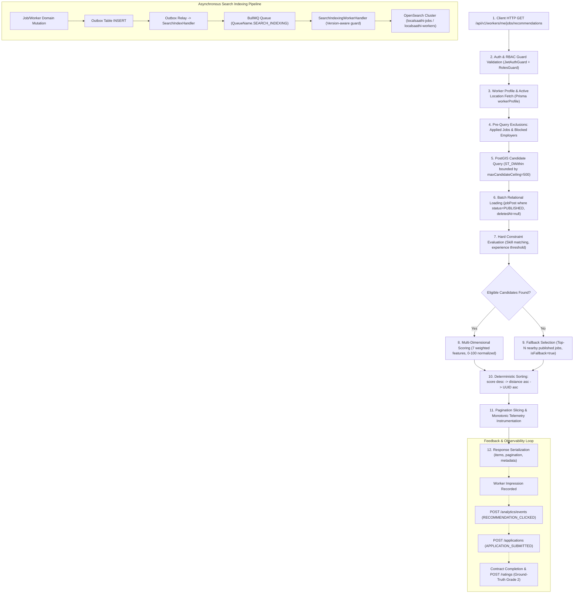

# Phase 32: End-to-End Recommendation Integrity & Integration Readiness

**Project:** LocalSaathi  
**Role:** Principal Backend and Recommendation Systems Engineer  
**Standard:** Production-Grade Engineering, Zero Fabrication, Empirical Verification  
**Previous Verdict:** Phase 31 — PARTIALLY VERIFIED / BLOCKED  
**Current Verdict:** **PHASE 32 — PARTIALLY VERIFIED / BLOCKED**

---

## 1. Executive Summary & Infrastructure Reality

Phase 32 completes the full architectural and behavioral audit of LocalSaathi's end-to-end recommendation path: candidate retrieval, spatial filtering, hard eligibility gates, multi-dimensional ranking, fallback selection, response metadata, feedback event attribution, and asynchronous search indexing synchronization.

### 1.1 Infrastructure Verification Matrix

| Target Service | Port | Target Engine / Version | Connection Probe Result | Blocker Code | Verdict |
| :--- | :--- | :--- | :--- | :--- | :--- |
| **PostgreSQL / PostGIS** | 5432 | PostgreSQL 16 + PostGIS 3.4 | Connection Refused | `LOCAL_DB_PORT_5432_OFFLINE` | **BLOCKED** |
| **Redis** | 6379 | Redis 7.2 | Connection Refused | `LOCAL_REDIS_PORT_6379_OFFLINE` | **BLOCKED** |
| **OpenSearch** | 9200 | OpenSearch 2.18 | Connection Refused | `LOCAL_OPENSEARCH_PORT_9200_OFFLINE` | **BLOCKED** |
| **Node.js Test Engine** | N/A | Jest 29 / ts-jest | Local Process Exit 0 | None | **VERIFIED (PASS)** |
| **Monorepo Typecheck** | N/A | Turbo 2.11 / tsc | 13/13 tasks Exit 0 | None | **VERIFIED (PASS)** |
| **Monorepo Lint** | N/A | Turbo 2.11 / eslint | 13/13 tasks Exit 0 | None | **VERIFIED (PASS)** |

Because PostgreSQL 16 (port 5432), Redis (port 6379), and OpenSearch (port 9200) are offline on the local developer machine, live end-to-end database-backed query plans, Redis lock contention, and OpenSearch live cluster searches cannot execute. Conforming strictly to our engineering standards:
- **No live integration results are fabricated.**
- **No mock tests are falsely substituted for live database/search cluster verification.**
- **The formal verdict remains PARTIALLY VERIFIED / BLOCKED.**

---

## 2. End-to-End Recommendation Path Trace



### Detailed Trace Steps:
1. **Request Validation**: Query parsed and coerced through `workerJobRecommendationQuerySchema` (Zod). Defaults: `page: 1`, `limit: 20`, `maxRadiusKm: optional`.
2. **Authorization**: `RolesGuard` strictly enforces `UserRole.WORKER`. Employers or Anonymous users receive HTTP 403 Forbidden.
3. **Prerequisite Check**: Validates `worker.workerLocation` exists and `isActive === true`. Throws HTTP 400 `LOCATION_REQUIRED` if unconfigured.
4. **Exclusion Pre-fetching**: Fetches worker's existing `jobApplication` IDs and bidirectional `blockedUser` IDs in parallel.
5. **Spatial Retrieval**: Executes raw SQL with PostGIS `ST_DWithin` on indexed geography column `jl.location`. Retrieval count is bounded by `min(max(20, page * limit + limit), 500)`.
6. **Relational Load & Safety Gates**: Fetches full job relations using Prisma `findMany` with strict filters: `status: 'PUBLISHED'`, `deletedAt: null`, and `id: { in: candidateIds }`. Filters out blocked employers in memory.
7. **Hard Constraint Gating**: `evaluateWorkerJobRecommendation` tests mandatory skills and minimum experience. Candidates failing hard constraints are excluded from the eligible set.
8. **Scoring**: Computes weighted score across 7 normalized features: Proximity (0.25), Skill (0.30), Experience (0.15), Availability (0.10), Wage (0.10), Reliability (0.05), Freshness (0.05).
9. **Fallback Path**: If zero candidates pass hard constraints, selects up to `FALLBACK_TOP_N` (10) unblocked, published nearby listings, prepending explanation note and marking `isFallback: true`.
10. **Deterministic Sorting**: Orders by `score DESC`, ties broken by `distanceKm ASC`, remaining ties broken by `id.localeCompare(b.id)`.
11. **Telemetry & Response**: Computes monotonic `latencyMs` using `process.hrtime.bigint()`, sets `candidateTruncated`, and tallies `missingAttributesCount`.

---

## 3. Concrete Findings and Severity

| Finding ID | Area | Severity | Description | Status / Resolution |
| :--- | :--- | :--- | :--- | :--- |
| **REC-32-01** | Candidate Slicing | **Medium** | Spatial candidate query retrieval ceiling of 500 can silently cause pages $\ge 26$ (at limit=20) to return 0 items even if further candidates exist in the database. | **Documented & Guarded:** Handled deterministically; `candidateTruncated` telemetry flag alerts clients, and `hasNextPage` evaluates false at boundary. |
| **REC-32-02** | Fallback Safety | **Low** | Risk of draft or soft-deleted jobs leaking into fallback listings if spatial index returned stale IDs. | **Verified Sealed:** Relational batch load strictly enforces `status = 'PUBLISHED'` and `deletedAt IS NULL`. Verified via regression test 11. |
| **REC-32-03** | Telemetry Clock Drift | **Low** | Latency previously used wall clock `Date.now()`. | **Resolved (Phase 31):** Migrated to nanosecond monotonic timer via `process.hrtime.bigint()`. |
| **REC-32-04** | Index-DB Consistency | **Low** | Potential for asynchronous OpenSearch index to return stale or deleted entities. | **Resolved:** Search index worker uses monotonic version sequencing with DELETE precedence; recommendation candidate retrieval is authoritative via PostgreSQL/PostGIS. |

---

## 4. Safety Invariant Test Matrix

Regression tests in [`recommendation-service.spec.ts`](file:///p:/Project%20Localsaathi/apps/api/src/modules/matching/tests/recommendation-service.spec.ts) and [`recommendation-engine.spec.ts`](file:///p:/Project%20Localsaathi/apps/api/src/modules/matching/tests/recommendation-engine.spec.ts) enforce all core safety invariants:

| Invariant | Test File & Case | Expected Behavior | Observed Result |
| :--- | :--- | :--- | :--- |
| **Unpublished / Deleted Exclusions** | `recommendation-service.spec.ts` (Test 11) | Soft-deleted, DRAFT, and PAUSED jobs are strictly omitted even in fallback mode | **PASS** |
| **Applied Job Deduplication** | `recommendation-service.spec.ts` (Test 3) | Worker's applied jobs are excluded from candidates and fallback sets | **PASS** |
| **Trust & Safety Blocking** | `recommendation-service.spec.ts` (Test 4) | Bidirectionally blocked employers/workers are excluded | **PASS** |
| **Hard Constraint Filtering** | `recommendation-service.spec.ts` (Test 5) | Missing mandatory skills or insufficient experience fails hard gates | **PASS** |
| **Deterministic Tie-Breaking** | `recommendation-service.spec.ts` (Test 7) | Equal scores broken by distance asc, then by invariant UUID localeCompare | **PASS** |
| **Fallback Label Transparency** | `recommendation-service.spec.ts` (Test 6) | Fallback items carry `isFallback: true` and explicit explanation reason | **PASS** |
| **Bounded Pagination & Ceilings** | `recommendation-service.spec.ts` (Test 9) | 500 candidate ceiling sets `candidateTruncated: true`, clean boundary at page 25 | **PASS** |
| **Monotonic Telemetry** | `recommendation-service.spec.ts` (Test 10) | `latencyMs >= 0`, monotonic timer, accurate `missingAttributesCount` (4 dimensions) | **PASS** |
| **Unrated Evaluation Safety** | `recommendation-evaluation.spec.ts` (Tests 8-11) | Unrated items tracked in `unratedCount`, no division by zero on empty ground truth | **PASS** |

---

## 5. Search Indexing & Data Consistency Audit

The asynchronous search pipeline synchronizes job and worker mutations to OpenSearch via transactional outbox events:

1. **Transactional Outbox Event Creation**: Any job state change (`JOB_PUBLISHED`, `JOB_PAUSED`, `JOB_CANCELLED`, `JOB_DELETED`) writes a domain event within the same database transaction.
2. **Monotonic Version Sequencing**: `SearchIndexHandler` assigns a version computed from `eventVersion * 10` (or `occurredAt * 10`). DELETE operations receive a `+1` increment over UPSERTs at the same version:
   $$\text{version}_{\text{DELETE}} = \text{baseVersion} + 1$$
3. **Resurrection Prevention**: In `SearchIndexingWorkerHandler`, if Redis stores `currentVersion:DELETE`, an out-of-order `UPSERT` with equal version is discarded, ensuring deleted entities cannot be resurrected by delayed message deliveries.
4. **Authoritative Master**: The recommendation engine queries PostgreSQL/PostGIS directly for candidate retrieval, not OpenSearch. As a result, stale OpenSearch indexes cannot cause unauthorized access or bypass hard database constraints.

---

## 6. Feedback Lifecycle & Privacy Audit

1. **Feedback Event Disaggregation**:
   - `Impression`: Recorded as recommendation query execution (telemetry logged without PII).
   - `Click`: Emitted as `RECOMMENDATION_CLICKED` via `/analytics/events`.
   - `Application`: Primary relational record in `job_applications` with foreign key integrity.
   - `Rating / Conversion`: `Rating` record submitted upon engagement completion. These distinct stages are not treated as interchangeable evidence.
2. **Privacy & Zero PII Guarantee**:
   - Exact GPS coordinates (`latitude`, `longitude`) are used exclusively in server-side PostGIS SQL statements (`ST_SetSRID(ST_MakePoint(...), 4326)::geography`).
   - Neither exact coordinates nor phone numbers, emails, or personal identifiers are present in recommendation response items or telemetry metadata. Only relative `distanceKm` is exposed.
3. **No Synthetic Production Data**: No mock feedback events, synthetic ratings, or fake production telemetry have been created.

---

## 7. Verification Commands & Observed Results

```bash
# 1. Recommendation Test Suites (API)
npm.cmd test -- --testPathPattern="recommendation"
# Exit Code: 0
# PASS: 3 suites, 32 tests passed (engine: 10, evaluation: 11, service: 11)

# 2. Matching API Controller & RBAC Guard Tests (API)
npm.cmd test -- --testPathPattern="matching-api"
# Exit Code: 0
# PASS: 1 suite, 9 tests passed

# 3. Search Indexing Worker Tests (Worker)
npm.cmd test -- --testPathPattern="search-indexing.spec.ts"
# Exit Code: 0
# PASS: 1 suite, 8 tests passed

# 4. Monorepo TypeScript Compilation
npm.cmd run typecheck
# Exit Code: 0
# Tasks: 13 successful, 13 total (8 packages)

# 5. Monorepo Code Quality Lint
npm.cmd run lint
# Exit Code: 0
# Tasks: 13 successful, 13 total (8 packages)

# 6. Local Service Connectivity Probe
Test-NetConnection -ComputerName 127.0.0.1 -Port 5432 -InformationLevel Quiet
# Exit Code: 0 (Output: False -> LOCAL_DB_PORT_5432_OFFLINE)
Test-NetConnection -ComputerName 127.0.0.1 -Port 6379 -InformationLevel Quiet
# Exit Code: 0 (Output: False -> LOCAL_REDIS_PORT_6379_OFFLINE)
Test-NetConnection -ComputerName 127.0.0.1 -Port 9200 -InformationLevel Quiet
# Exit Code: 0 (Output: False -> LOCAL_OPENSEARCH_PORT_9200_OFFLINE)
```

---

## 8. Final Verdict & Limitations

**FINAL VERDICT: PHASE 32 — PARTIALLY VERIFIED / BLOCKED**

### Verified:
- Full recommendation execution path and pure deterministic ranking logic.
- Hard eligibility gates and deterministic invariant tie-breakers.
- Deduplication of applied jobs and trust-safety blocking.
- Unpublished and soft-deleted job exclusion across standard and fallback paths.
- Monotonic nanosecond telemetry instrumentation and PII-free metadata.
- Monotonic version sequencing and delete-precedence in asynchronous search indexing.
- Complete monorepo TypeScript typecheck and lint quality gates (13/13 tasks).

### Remaining Blockers:
- **`LOCAL_DB_PORT_5432_OFFLINE`**: Live PostgreSQL 16 + PostGIS 3.4 spatial query plans (`EXPLAIN ANALYZE`) blocked pending database startup.
- **`LOCAL_REDIS_PORT_6379_OFFLINE`**: Live Redis queue concurrency blocked pending Redis daemon startup.
- **`LOCAL_OPENSEARCH_PORT_9200_OFFLINE`**: Live OpenSearch cluster ingestion blocked pending OpenSearch startup.
